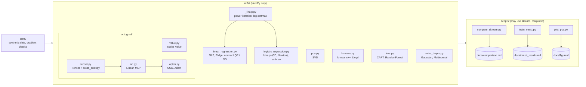
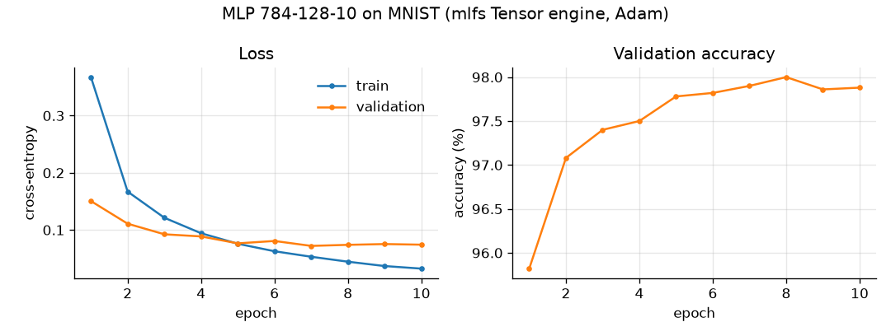
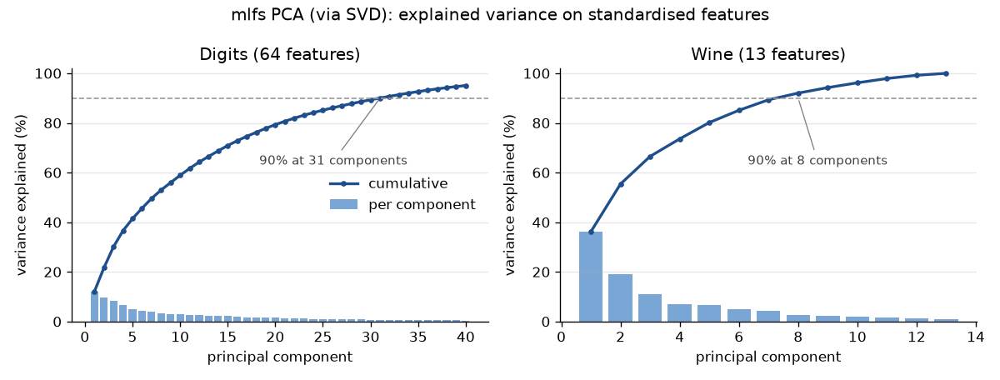

# ml-from-scratch


I built the core classical machine-learning models and a small deep-learning stack from
scratch in NumPy, to show I can turn the linear algebra and calculus behind them into
working code. `mlfs/` contains linear and ridge regression (normal equation, my own
Householder QR, and gradient descent), PCA via SVD, L2 logistic and softmax regression
(gradient descent and Newton/IRLS), k-means with k-means++, CART decision trees and
random forests, Gaussian and multinomial naive Bayes, and a reverse-mode autograd
engine (a scalar `Value` and a broadcasting `Tensor`) with `Linear`/`MLP` modules and
SGD/Adam optimisers. Every model is checked against scikit-learn on the same data
splits, every autograd op is checked against finite differences, and a 784-128-10 MLP
trained with my `Tensor` engine reaches **97.64% test accuracy on MNIST**.

## Architecture



The library itself imports only NumPy. scikit-learn, matplotlib and pandas appear
only in `scripts/` (data loading, reference models, plots) and in a few tests that use
sklearn as an oracle.

## How to run

From a fresh clone (Python 3.11+; I use [uv](https://docs.astral.sh/uv/)):

```bash
uv venv .venv && uv pip install -e ".[dev]"
source .venv/bin/activate

ruff check .                      # lint
pytest                            # 146 tests, ~4 s, no network

python scripts/compare_sklearn.py # ~15 s, rewrites docs/comparison.md
python scripts/plot_pca.py        # rewrites docs/figures/pca_explained_variance.png
python scripts/train_mnist.py     # downloads MNIST (~11 MB) into data/ once, then trains
```

`train_mnist.py` fetches the four IDX files from the public OSSCI mirror, parses them
with NumPy and caches them as `data/mnist.npz` (gitignored; override the location with
`MLFS_DATA_DIR`). Flags: `--epochs`, `--hidden`, `--batch-size`, `--lr`, `--seed`.

## Results

### mlfs vs scikit-learn

Same 75/25 split (`random_state=0`, stratified for classification), features
standardised on the training split, matched hyperparameters. Accuracy and R² are on
the test split; ARI is k-means agreement with the true labels; EVR is PCA's
explained-variance ratio. Full output in [docs/comparison.md](docs/comparison.md).

| Dataset | Model | Metric | mlfs | scikit-learn | Δ |
|---|---|---|---:|---:|---:|
| diabetes | LinearRegression (normal) | R² | 0.3594 | 0.3594 | -0.0000 |
| diabetes | LinearRegression (qr) | R² | 0.3594 | 0.3594 | +0.0000 |
| diabetes | LinearRegression (gd) | R² | 0.3594 | 0.3594 | -0.0000 |
| diabetes | Ridge α=1 (qr) | R² | 0.3570 | 0.3570 | +0.0000 |
| iris | SoftmaxRegression L2, C=1.0 (GD) | accuracy | 0.9737 | 0.9737 | +0.0000 |
| iris | GaussianNB | accuracy | 0.9737 | 0.9737 | +0.0000 |
| iris | DecisionTree (gini) | accuracy | 0.9474 | 0.9737 | -0.0263 |
| iris | DecisionTree (entropy, depth≤5) | accuracy | 0.9211 | 0.9474 | -0.0263 |
| iris | RandomForest (100 trees, √d features) | accuracy | 0.9737 | 0.9474 | +0.0263 |
| wine | SoftmaxRegression L2, C=1.0 (GD) | accuracy | 1.0000 | 1.0000 | +0.0000 |
| wine | GaussianNB | accuracy | 0.9556 | 0.9556 | +0.0000 |
| wine | DecisionTree (gini) | accuracy | 0.8889 | 0.8889 | +0.0000 |
| wine | DecisionTree (entropy, depth≤5) | accuracy | 0.9111 | 0.9333 | -0.0222 |
| wine | RandomForest (100 trees, √d features) | accuracy | 1.0000 | 1.0000 | +0.0000 |
| breast_cancer | LogisticRegression L2, C=1.0 (Newton) | accuracy | 0.9580 | 0.9580 | +0.0000 |
| breast_cancer | GaussianNB | accuracy | 0.9091 | 0.9091 | +0.0000 |
| breast_cancer | DecisionTree (gini) | accuracy | 0.9091 | 0.9021 | +0.0070 |
| breast_cancer | DecisionTree (entropy, depth≤5) | accuracy | 0.9371 | 0.9231 | +0.0140 |
| breast_cancer | RandomForest (100 trees, √d features) | accuracy | 0.9510 | 0.9441 | +0.0070 |
| digits | SoftmaxRegression L2, C=1.0 (GD) | accuracy | 0.9711 | 0.9689 | +0.0022 |
| digits | GaussianNB | accuracy | 0.8067 | 0.8067 | +0.0000 |
| digits | DecisionTree (gini) | accuracy | 0.8667 | 0.8556 | +0.0111 |
| digits | DecisionTree (entropy, depth≤5) | accuracy | 0.8089 | 0.8067 | +0.0022 |
| digits | RandomForest (100 trees, √d features) | accuracy | 0.9733 | 0.9778 | -0.0044 |
| digits | MultinomialNB (raw counts) | accuracy | 0.9044 | 0.9044 | +0.0000 |
| iris | KMeans k=3 (k-means++, n_init=10) | ARI | 0.6201 | 0.6201 | +0.0000 |
| wine | KMeans k=3 (k-means++, n_init=10) | ARI | 0.8975 | 0.8975 | +0.0000 |
| breast_cancer | KMeans k=2 (k-means++, n_init=10) | ARI | 0.6707 | 0.6536 | +0.0171 |
| digits | KMeans k=10 (k-means++, n_init=10) | ARI | 0.4629 | 0.4679 | -0.0051 |
| wine | PCA: variance explained by 2 PCs | EVR | 0.5541 | 0.5541 | -0.0000 |
| digits | PCA: variance explained by 2 PCs | EVR | 0.2159 | 0.2159 | +0.0000 |

The linear models, naive Bayes, PCA and k-means on iris/wine match sklearn exactly,
which is what I expect for convex problems or closed-form estimators with matched
settings. Trees and forests differ by one or two test samples: when several splits tie
on impurity, sklearn picks among them in a randomly permuted feature order and I take
the first, so the trees diverge; forests also consume randomness differently and I use
a hard majority vote where sklearn averages probabilities. k-means on breast_cancer and
digits lands in a different local optimum (sklearn uses greedy k-means++ with several
candidates per step; I use the plain D² sampling).

### MNIST with my autograd engine

784-128-10 ReLU MLP (101,770 parameters, float32), Adam (lr 1e-3), batch size 128,
10 epochs, 55k/5k train/validation split, test set evaluated once at the end:

**Test accuracy 97.64%** (test loss 0.081). Training took about 2 seconds on my laptop's
CPU. Details in [docs/mnist_results.md](docs/mnist_results.md).



### PCA



## Verification

- **Linear regression:** the normal-equation, QR and gradient-descent solvers agree with
  each other and with `np.linalg.lstsq` to 1e-6; my Householder QR matches
  `np.linalg.qr` up to column signs; ridge matches sklearn to 1e-8.
- **Classifiers:** logistic (Newton) and softmax probabilities match sklearn's
  `LogisticRegression` once the regularisation is converted (λ = 1/(C·n)); GD and
  Newton reach the same coefficients; naive Bayes probabilities match sklearn to 1e-10;
  a depth-3 tree reproduces sklearn's predictions and feature importances.
- **Autograd:** every `Value` and `Tensor` op is compared with central finite differences,
  including broadcasting shapes like `(3, 1) * (1, 4)` and `(2, 3, 4) + (3, 1)`, batched
  matmul, reductions over several axes, `log_softmax`, the fused cross-entropy and a
  two-layer network end to end.
- **Optimisers:** Adam is checked step by step against the textbook formula and its first
  step is exactly `lr * sign(g)`; SGD momentum against a hand-computed update.

Derivations for the normal equation, the logistic and softmax gradients, backprop through
an MLP layer and the Adam update are in [docs/derivations.md](docs/derivations.md).

## Design decisions

- **Solve, don't invert.** The normal equation uses `np.linalg.solve`. The QR path never
  forms XᵀX at all, so its error scales with κ(X) instead of κ(X)². Ridge reuses the QR
  path by stacking √α·I under X.
- **Step sizes from theory.** Gradient descent defaults to 1/L, where L is the gradient's
  Lipschitz constant (σ_max(X)²/n for least squares, /4n for logistic, /2n for softmax),
  estimated by power iteration. No learning-rate tuning needed, and the loss provably
  decreases every step (a test checks this).
- **Broadcasting handled once.** Each `Tensor` op returns gradients in the output's
  shape; the engine's `unbroadcast` sums them back to each input's shape. That keeps
  every op's backward rule to one or two lines and puts the subtle part in one tested
  function.
- **Fused cross-entropy.** `cross_entropy` computes log-softmax with the max-subtraction
  trick and returns the gradient (softmax − one-hot)/n directly. A test checks that it
  agrees with the unfused composition and stays finite for logits of ±1000.
- **Iterative topological sort.** Both engines sort the graph with an explicit stack, so
  a 5,000-step chain doesn't hit Python's recursion limit.
- **Vectorised split search.** The tree sorts each feature once and evaluates every
  threshold at once from cumulative class counts, so a split costs O(n log n) per feature
  instead of O(n²).
- **Seeded and small.** All tests use fixed seeds and synthetic data of at most a few
  hundred rows, so the suite runs in seconds without network access.

## Limitations

- CPU only, float32/float64 NumPy; no GPU, no convolution or recurrent layers.
- `Tensor.__matmul__` requires at least 2-D operands (reshape vectors first), and powers
  take constant exponents only. There is no `no_grad` mode; evaluation simply builds a
  graph that is discarded.
- Trees build recursively in Python. The 100-tree forest on digits trains in a few
  seconds, but this would be slow on large datasets; there is no pruning beyond
  `max_depth`, `min_samples_split` and `min_samples_leaf`, and no regression trees.
- `LogisticRegression` is binary; multi-class uses `SoftmaxRegression` (gradient descent
  only, no Newton). Newton without a line search can diverge on separable data with no
  regularisation.
- The comparison uses one train/test split per dataset, so differences of one or two
  test samples are noise, not evidence that either implementation is better.
- MNIST accuracy is from one seed and one run; I did not tune the architecture.

## License

MIT, see [LICENSE](LICENSE).
