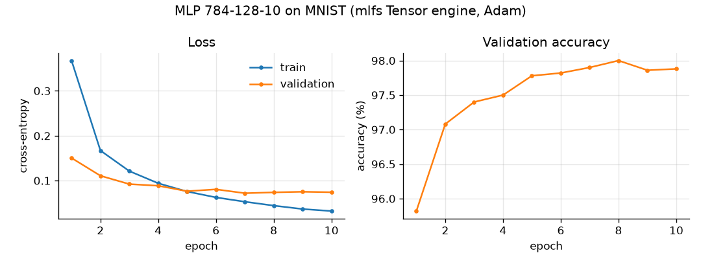

# MNIST with the mlfs Tensor engine

Generated by `python scripts/train_mnist.py` (seed 0).

- Architecture: 784-128-10 MLP with ReLU, 101,770 parameters, float32
- Optimiser: Adam, lr 0.001, batch size 128, 10 epochs
- Split: 55,000 train / 5,000 validation (last 5k of the official train set) / 10,000 test
- Training time: 2.0s on CPU

**Test accuracy: 97.64%** (test loss 0.0809), evaluated once after training.

| epoch | train loss | val loss | val accuracy |
|---:|---:|---:|---:|
| 1 | 0.3675 | 0.1505 | 95.82% |
| 2 | 0.1671 | 0.1109 | 97.08% |
| 3 | 0.1213 | 0.0923 | 97.40% |
| 4 | 0.0942 | 0.0886 | 97.50% |
| 5 | 0.0758 | 0.0765 | 97.78% |
| 6 | 0.0627 | 0.0806 | 97.82% |
| 7 | 0.0530 | 0.0720 | 97.90% |
| 8 | 0.0444 | 0.0739 | 98.00% |
| 9 | 0.0368 | 0.0752 | 97.86% |
| 10 | 0.0323 | 0.0742 | 97.88% |

